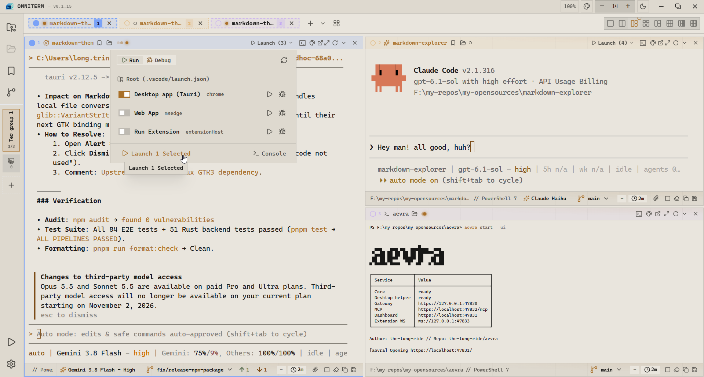

<h1 align="center">OmniTerm</h1>

<p align="center">
  <strong>A fast, lightweight multi-window terminal workspace built for modern developers and AI workflows.</strong>
</p>

<p align="center" >
  <i >Local first - No telemetry - No touching any your data or information</i>
</p>

<p align="center">
  <a href="https://github.com/hainguyenh/OmniTerm/releases/latest"></a>
  <a href="https://github.com/hainguyenh/OmniTerm/actions"></a>
  <a href="LICENSE"></a>
</p>

<p align="center">
  
</p>

---

## What Makes OmniTerm Special?

- **Lightweight Native Speed** — Built on Rust (Tauri 2) and native PTYs. Starts instantaneously with minimal memory footprint, free from Electron bloat.
- **True Multi-Window & Tile Panes** — Tile terminal panes with flexible split layouts, or pop any terminal out into its own dedicated desktop window with full detach and re-dock support.
- **Extensible Plugin Ecosystem** — Powered by an isolated out-of-process Node.js sidecar runtime with strict TypeScript contracts (`@omniterm/contract`). OmniTerm includes **6 official built-in plugins**:
  - **VS Code Launch Runner (`vscode-launch`)** — Discovers and executes `.vscode/launch.json` run and debug configurations directly from terminal headers, with interactive multi-console drawers.
  - **AI Agent Quota Monitor (`agent-quota`)** — Real-time rate-limit and token tracking per pane, automatic agent suspension at quota limits, and scheduled wakeups.
  - **Always Awake (`always-awake`)** — Keeps the host system awake during active builds, long-running agent tasks, or critical terminal sessions.
  - **Blur Focus Mode (`blur`)** — Distraction-free privacy filter that smoothly blurs inactive terminal windows.
  - **Full Connection Manager (`full-connection-manager`)** — Comprehensive remote session suite for SSH, Telnet, and serial connections with metadata-only profiles.
  - **Native Batch Connections (`native-batch-connections`)** — Lightweight, password-free session launcher backed by OS-native launch scripts.
- **Built for AI Coding Agents** — First-class environment for AI agent CLIs (Claude Code, Codex, Antigravity, Aider) with live progress tracking, token quota bars, and automated lifecycle controls.
- **Per-Pane Visual Color Coding & Themes** — Assign unique color badges to panes for rapid multitasking. Includes Tokyo Night, The Long Ride (TLR), and a visual Theme Remix editor with real-time UI/terminal color styling.
- **Zero Credential Persistence** — Private and secure by design. OmniTerm never writes passwords, SSH keys, or access tokens to disk.
- **Integrated Developer Tooling** — Built-in visual Git graph with commit inspection and two-way diffs, alongside real-time Markdown and Mermaid diagram preview.

---

<details>
<summary><b>View Full Feature List</b></summary>

### Terminal & Multiplexing

- **True Multi-Window Workspace** — Tear off any tab into a standalone native window, or re-dock it back into the main grid.
- **Flexible Tiling & Split Panes** — Horizontal and vertical splits with configurable grid ratios and pane resizing.
- **Shell Support** — Native shells including PowerShell, Command Prompt, Bash, Zsh, WSL, SSH, and serial ports.
- **Pane Color Coding** — Custom color badges and custom tab titles per pane for rapid visual identification.

### AI Agent & Developer Workflow

- **AI TUI Optimization** — Tailored for autonomous agent CLIs with quota progress indicators, status glyphs, and suspend/wake triggers.
- **Embedded VS Code Runner** — Detects and runs `.vscode/launch.json` compound and individual debug targets directly in terminal drawers.
- **Git Visualization** — Integrated visual commit tree, branch navigation, and side-by-side file diffs.
- **Markdown & Mermaid Live Preview** — Render documentation, architecture diagrams, and task lists without leaving the terminal.

### Plugins & Extensibility

- **Isolated Node.js Sidecar** — Plugin runtime executes out-of-process, guaranteeing core terminal stability and safety.
- **Typed Plugin Contract** — Type-safe SDK (`@omniterm/contract`) for building custom toolbars, drawers, and background automations.
- **6 Packaged Plugins** — Ready-to-use plugins for AI quota tracking, sleep prevention, window blurring, launch runners, and remote connections.

### Customization & Security

- **Modern Themes** — Ships with Tokyo Night, The Long Ride (TLR), and high-contrast dark/light palettes.
- **Theme Remix Editor** — Visual theme customizer with instant CSS variable updates and per-theme export/import.
- **Zero Credential Storage** — Passwords, SSH passphrases, and tokens are never persisted to disk.
- **Local-First & Offline** — Entirely local execution with zero network telemetry or background tracking.

</details>

---

## Quick Start

### Download

Get the latest installer or portable package for Windows, Linux, and macOS from [GitHub Releases](https://github.com/hainguyenh/OmniTerm/releases/latest).

### Run Locally

```bash
git clone --recurse-submodules https://github.com/hainguyenh/OmniTerm.git
cd OmniTerm
pnpm install
pnpm tauri dev
```

---

## Documentation

- [Installation & Development Guide](GUIDELINE.md) — Prerequisites, build scripts, and CLI workflows.
- [Product & Architecture Specs](docs/specs/README.md) — In-depth component and protocol specifications.

---

## License

[MIT](LICENSE)
